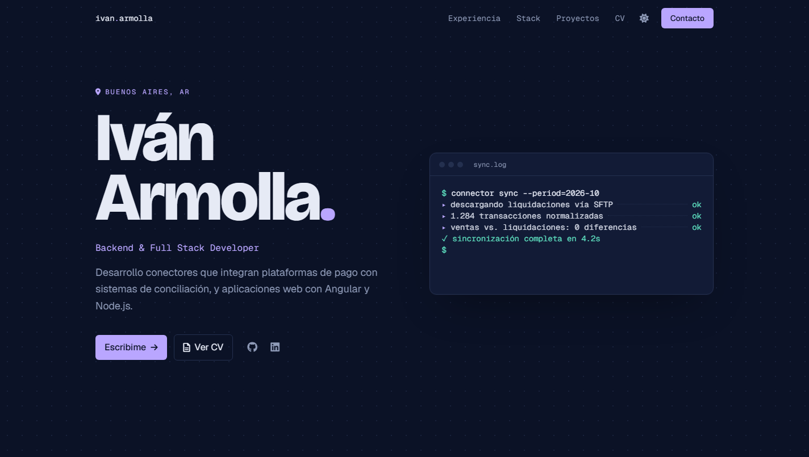

# Portfolio — v2 📁

Portfolio personal de Iván Armolla, desarrollador backend y full stack. Una sola página con mi experiencia, el stack que usé en cada trabajo, proyectos personales y un formulario de contacto.

La v2 es un rediseño completo con dirección visual **"Consola nocturna"**: fondo azul tinta, acentos en lavanda y, en la portada, una terminal que simula la sincronización de un conector de pagos (lo que hago en mi trabajo diario).

## Características 📋

- **Portada** con una terminal animada (`sync.log`) que escribe en loop
- **Sobre mí** con datos rápidos (trabajo actual, años de experiencia, estudios, idiomas)
- **Experiencia**: línea de tiempo con trabajos y estudios, que se dibuja al hacer scroll
- **Stack**: matriz de tecnologías × lugares de trabajo, en orden cronológico
- **Proyectos** con captura, demo y enlace al código
- **Contacto** con formulario (Formspree), validación y botón para copiar el email
- **Tema oscuro por defecto y tema claro**, con transición circular al cambiar
- Navegación fija que marca la sección activa y barra de progreso de lectura
- Responsive, accesible por teclado y respetuoso de `prefers-reduced-motion`
- SSR y prerender con Angular

## Tecnologías 🛠️

Angular 18 (componentes standalone, signals, SSR) · Tailwind CSS · Font Awesome · Formspree

Tipografías: Bricolage Grotesque, Geist y Geist Mono (Google Fonts).

## Instalación ⚙️

```bash
npm install
npm start            # servidor de desarrollo en http://localhost:4200
```

Para el formulario de contacto, registrate en [Formspree](https://formspree.io/), creá un formulario y poné su endpoint en `formspreeUrl` dentro de `src/environments/environment.ts`. En ese mismo archivo están los enlaces a LinkedIn, GitHub y el email.

## Scripts

| Comando | Qué hace |
| --- | --- |
| `npm start` | Servidor de desarrollo |
| `npm run build` | Build de producción con prerender en `dist/portfolio` |
| `npm run serve:ssr:portfolio` | Sirve el build con SSR en http://localhost:4000 |
| `npm test` | Tests unitarios (Karma + Jasmine) |

## Editar el contenido ✏️

| Qué | Dónde |
| --- | --- |
| Trabajos y estudios (línea de tiempo) | `src/app/core/services/experience.service.ts` |
| Proyectos y filas de la matriz de stack | `src/app/core/services/projects.service.ts` |
| Texto de la terminal de la portada | `src/app/shared/components/hero/sync-log.component.ts` |
| CV en PDF | `src/assets/ivanarmolla.pdf` |
| Colores (tokens de ambos temas) y curvas de animación | `src/styles.css` |

La matriz de stack se calcula sola: cada tecnología de `projects.service.ts` tiene alias (por ejemplo, PHP / Laravel) que se buscan en el stack de cada trabajo y proyecto. Si agregás un trabajo o un proyecto, la matriz se actualiza sin tocar nada más.
